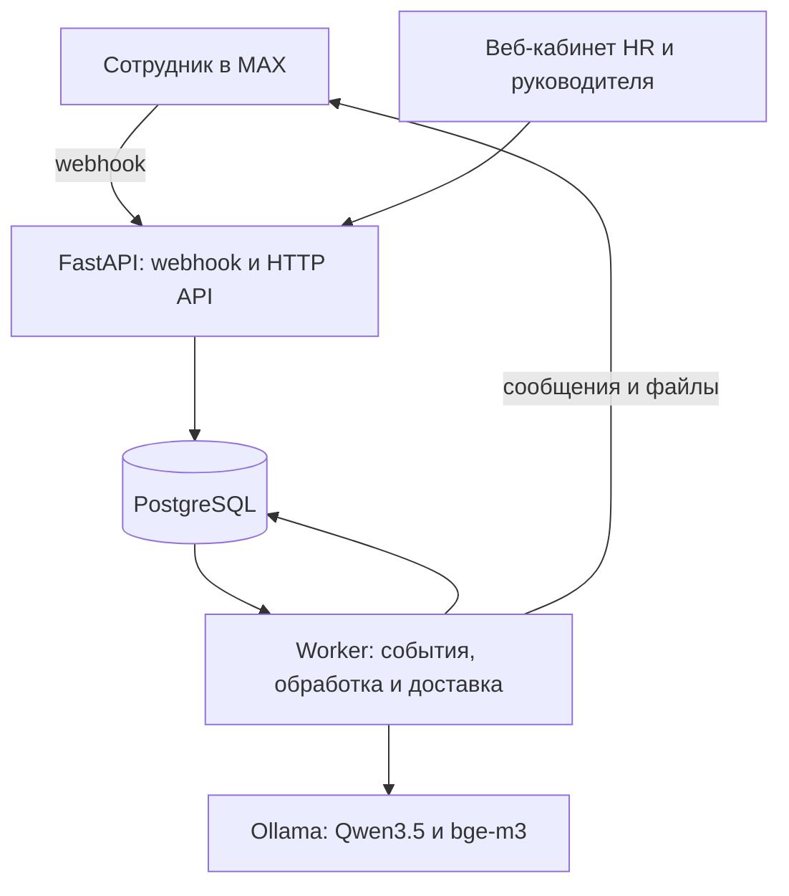

# Корсик — HR-помощник в MAX

Корсик сопровождает нового сотрудника от приглашения до завершения испытательного срока: присылает материалы по расписанию, проводит опросы, отвечает на вопросы по корпоративным документам и передаёт обращения HR.

Сотрудник остаётся в одном чате MAX. HR работает в веб-кабинете и при необходимости отвечает в тот же чат от имени Корсика. Внутри системы сохраняется автор сообщения: сценарий, LLM или HR.

**Основная версия приложения находится в каталоге `korsik_v2`.** Команды ниже выполняются из этого каталога. README предназначен для размещения в корне репозитория.

## Возможности

- Карточки сотрудников, персональные приглашения в MAX, выбор обращения «ты/вы».
- Сценарий адаптации из Excel: события, материалы, календарь и разрешения HR.
- Опросы: выбор ответа, шкалы, несколько вариантов, комментарии и напоминания.
- RAG по корпоративной базе знаний с указанием документа и страницы или слайда.
- Анализ обратной связи: тональность, темы, проблемные сигналы и приоритет обращения.
- Подключение HR к диалогу и возврат управления боту.
- Извлечение полей карточки из кадровых документов с подтверждением HR.
- Персональный план адаптации: отправка по сценарию; в сборке с `personal_plan.py` — также по запросу сотрудника.
- Аналитика адаптации, обращения, уведомления и недельный дайджест.

## Архитектура и стек



| Компонент | Назначение |
|---|---|
| Python, FastAPI, Uvicorn | HTTP API, webhook MAX, авторизация и кабинет |
| PostgreSQL 16 | Сотрудники, диалоги, сценарий, очереди, обращения, версии корпуса и эмбеддинги |
| Отдельный worker | Приём событий, scheduler, доставка, OCR и вызовы моделей |
| React, TypeScript, Vite | Кабинеты HR и руководителей |
| Ollama + Qwen3.5 4B | Генерация ответов и анализ обратной связи |
| bge-m3 | Эмбеддинги документов и вопросов |
| BM25 + dense + RRF | Гибридный поиск по корпоративному корпусу |
| Tesseract, PyMuPDF и библиотеки Office | Извлечение текста из PDF, сканов, DOCX и PPTX |
| Docker Compose | Запуск БД, API и worker |
| HTTPS-туннель | Доступ MAX к локальному webhook |

Ollama работает на хосте. Контейнеры обращаются к ней через `host.docker.internal:11434`. Очереди задач и исходящих сообщений хранятся в PostgreSQL. Быстрый цикл worker обслуживает события и доставку, тяжёлый — LLM, OCR и сборку корпуса.

## Модели

На проверенном локальном стенде `poliplastik-qwen:latest` — пользовательское имя **Qwen3.5 4B**, архитектура `qwen35`, около 4.2 млрд параметров, квантование `Q4_K_M`. Отдельное дообучение в рамках проекта не выполнялось.

В текущей конфигурации:

```dotenv
OLLAMA_MODEL=poliplastik-qwen:latest
EMBED_MODEL=bge-m3
```

`OLLAMA_MODEL` используется общим клиентом генерации: для RAG, анализа обратной связи и дополнительного извлечения полей из документов. `EMBED_MODEL` отвечает только за эмбеддинги. Отдельная модель Qwen2.5 для тональности не настроена.

Проверить фактическую модель и версию сервера:

```powershell
ollama show poliplastik-qwen:latest
Invoke-RestMethod http://127.0.0.1:11434/api/version
```

Имя `poliplastik-qwen` само по себе не гарантирует конкретную архитектуру на другом компьютере. Если этот локальный тег отсутствует, загрузите официальный тег и укажите его в `OLLAMA_MODEL`:

```powershell
ollama pull qwen3.5:4b-q4_K_M
ollama pull bge-m3
```

В обновлённом клиенте генерации передаётся `think=false`. Это предотвращает расход короткого выходного бюджета на скрытые рассуждения. Переменная `OLLAMA_THINK` работает только в сборке, где её чтение реализовано в `config.py` и `llm.py`; добавлять её в `.env` без поддержки в коде недостаточно.

## Первый запуск на Windows

### 1. Подготовить окружение

Нужны Docker Desktop с запущенным Linux engine, Docker Compose и работающая Ollama с выбранной моделью и `bge-m3`.

```powershell
cd .\korsik_v2
docker info
ollama list
```

Python и Node.js на Windows для обычного Docker-запуска не требуются. Собранный интерфейс включён в backend, Tesseract устанавливается в Docker-образ.

### 2. Создать конфигурацию

Только для новой установки:

```powershell
Copy-Item .\.env.example .\.env
notepad .\.env
```

Существующий рабочий `.env` сохраняйте. Минимальные настройки для локальной проверки:

```dotenv
POSTGRES_PASSWORD=REPLACE_WITH_A_LONG_RANDOM_PASSWORD

TRANSPORT=console
HR_LOGIN=hr
COOKIE_SECURE=false

OLLAMA_URL=http://host.docker.internal:11434
OLLAMA_MODEL=poliplastik-qwen:latest
OLLAMA_NUM_CTX=8192
OLLAMA_TIMEOUT=120
LLM_MAX_ANSWER_TOKENS=700
EMBED_MODEL=bge-m3

MAX_BOT_TOKEN=
MAX_BOT_URL=https://max.ru/YOUR_BOT
MAX_API_BASE_URL=https://platform-api2.max.ru
MAX_WEBHOOK_SECRET=REPLACE_WITH_RANDOM_ASCII_SECRET
PUBLIC_BASE_URL=
CLOUDFLARE_TUNNEL_TOKEN=

DEFAULT_TIMEZONE=Europe/Moscow
DEFAULT_SEND_TIME=10:00
REMINDER_TIME=10:00
STALE_HOURS=24
DIGEST_WEEKDAY=0
DIGEST_TIME=09:00
```

Замените пароль БД и секрет webhook своими значениями. Секрет MAX: 5–256 символов `A-Z`, `a-z`, `0-9`, `_`, `-`. Для нового секрета можно использовать `[guid]::NewGuid().ToString("N")`.

В Compose строка `DATABASE_URL` формируется для сервиса `db` автоматически. Изменение `POSTGRES_PASSWORD` в `.env` не меняет пароль уже созданной базы.

### 3. Запустить сервисы

```powershell
docker compose up -d --build app worker
docker compose ps
Invoke-RestMethod http://127.0.0.1:8000/ready | ConvertTo-Json -Depth 8
```

Миграции выполняются при старте API. `/health` проверяет доступность процесса; `/ready` показывает состояние БД, корпуса, моделей, транспорта и очереди. Успешный HTTP-ответ `/ready` не означает, что все его компоненты готовы: проверяйте содержимое JSON.

### 4. Создать HR

```powershell
docker compose exec app python -m korsik.cli create-hr --login hr --name "HR-специалист"
```

Пароль вводится в приглашении CLI. Кабинет: **http://127.0.0.1:8000**. Для руководителей предусмотрена команда `create-manager` и раздел кабинета «Руководители и MAX».

### 5. Загрузить базу знаний

Поместите утверждённые корпоративные документы в `seed/corpus`, затем выполните:

```powershell
docker compose exec app python -m korsik.cli seed-corpus /app/seed/corpus
docker compose exec app python -m korsik.cli ask "Можно ли принимать денежные подарки?"
```

Для базового корпуса используются антикоррупционная политика, политика качества и экологии, положение о коммерческой тайне и правила внутреннего трудового распорядка. Личные документы сотрудников и описание хакатонного кейса не являются корпоративными регламентами.

Альтернатива — раздел **«База знаний»** в кабинете. Наличие загруженного файла ещё не означает, что он опубликован в активном корпусе.

## Подключение MAX

### Сертификат API

Если `max-check` завершается с `CERTIFICATE_VERIFY_FAILED`, добавьте доверенный сертификат API в CA bundle контейнеров. Используйте сертификат из доверенного источника, не отключая проверку TLS.

Сохраните PEM-файл как `data/certs/max-public-ca.pem`. Затем соберите bundle в работающем контейнере:

```powershell
New-Item -ItemType Directory -Force .\data\certs

@'
from pathlib import Path
import ssl
import certifi

folder = Path("/app/data/certs")
bundle = folder / "ca-bundle.pem"
bundle.write_bytes(
    Path(certifi.where()).read_bytes()
    + b"\n"
    + (folder / "max-public-ca.pem").read_bytes()
)
ssl.create_default_context(cafile=str(bundle))
print("CA bundle ready:", bundle)
'@ | docker compose exec -T app python -
```

В `.env`:

```dotenv
TRANSPORT=max
MAX_BOT_TOKEN=YOUR_BOT_TOKEN
MAX_BOT_URL=https://max.ru/YOUR_BOT
MAX_CA_BUNDLE=/app/data/certs/ca-bundle.pem
SSL_CERT_FILE=/app/data/certs/ca-bundle.pem
```

Первая переменная CA используется адаптером MAX, вторая — HTTPX при остальных HTTPS-запросах, включая загрузку файлов.

```powershell
docker compose up -d --force-recreate app worker
docker compose exec app python -m korsik.cli max-check
docker compose exec app python -m korsik.cli subscriptions
```

Проверяйте существующие подписки до регистрации нового адреса. Другие работающие подключения того же бота могут мешать ручному тесту.

### Временный HTTPS-туннель

В отдельном окне PowerShell:

```powershell
docker run --rm --name korsik-max-tunnel --network korsik_v2_default cloudflare/cloudflared:latest tunnel --no-autoupdate --url http://app:8000
```

Команда предполагает стандартное имя Compose-проекта `korsik_v2`. Дождитесь адреса `https://…trycloudflare.com` и оставьте окно открытым.

Запишите полученный адрес без `/webhook/max` в `.env`:

```dotenv
PUBLIC_BASE_URL=https://YOUR_TUNNEL.trycloudflare.com
```

В основном окне:

```powershell
docker compose up -d --force-recreate app worker
docker compose exec app python -m korsik.cli subscribe-webhook
docker compose exec app python -m korsik.cli subscriptions
```

Ожидается `{"success": true}` и подписка на `PUBLIC_BASE_URL/webhook/max`. CLI регистрирует `bot_started`, `message_created` и `message_callback`.

Временный туннель предназначен для демонстрации и тестов: после остановки адрес перестаёт работать, новый запуск может выдать другой URL. Эта команда публикует весь HTTP-сервис. Для постоянного размещения нужны стабильный адрес и отдельная настройка доступа к кабинету; если кабинет используется по HTTPS, настройте `COOKIE_SECURE=true`.

## Путь сотрудника и HR

1. HR создаёт черновик сотрудника и заполняет данные вручную или подтверждает предложения из документов.
2. Во вкладке **«Приглашение MAX»** создаёт персональную ссылку и передаёт сотруднику.
3. Сотрудник открывает ссылку. MAX-аккаунт привязывается к карточке, начинается преонбординг.
4. После подтверждения даты выхода, организации и часового пояса HR нажимает **«Запустить сопровождение»**. Тег и формат работы определяют применимые ветки.
5. Scheduler отправляет события, сотрудник отвечает кнопками или текстом и задаёт свободные вопросы.
6. При нехватке подтверждённого ответа или необходимости помощи создаётся обращение HR.
7. HR берёт диалог в работу, отвечает в том же MAX-чате и явно возвращает управление Корсику.

| Режим диалога | Поведение |
|---|---|
| `auto` / «Корсик» | Сценарий и автоматические ответы |
| `waiting_hr` / «Ждёт HR» | Есть открытое обращение; новые вопросы могут обрабатываться автоматически |
| `hr_active` / «HR в работе» | Диалог ведёт HR, автоматические сообщения приостановлены |

Приглашение персональное, действует 14 дней и привязывает одну карточку к одному аккаунту MAX. Новое приглашение отзывает предыдущее неиспользованное.

## Документы и материалы

| Раздел кабинета | Что загружать | Для чего |
|---|---|---|
| **База знаний** | Общие утверждённые политики и инструкции | Ответы RAG с источниками |
| **Карточка и документы → Документы сотрудника** | Кадровую анкету, оффер, сканы с данными | Предложенные поля карточки; HR нажимает «Принять» или «Отклонить» |
| **Карточка → Материалы** | Персональный адаптационный план | Выдача файла этому сотруднику |
| **Сценарий и материалы** | Изображения, презентацию, контакты и вложения сценария | Отправка по событию или кнопке |

Приватные документы не включаются в корпоративный корпус. Извлечённые значения не заменяют подтверждённые данные без решения HR. Загрузка файла в материалы сценария сама по себе не индексирует его для RAG.

Персональный план отправляется на соответствующем шаге после разрешения HR и появления файла. Если установлен обработчик `personal_plan.py`, доступны `/plan` и фраза **«Пришли мой план адаптации»**. Обработчик выдаёт последний активный файл этой карточки. Ответы на вопросы по содержимому персонального PDF этим обработчиком не реализованы.

В `demo_documents`, если добавлен комплект учебных материалов, находятся план, PDF для извлечения полей и его скан-копия. Контакты в них тестовые; используйте их для ручного прогона.

## RAG и анализ обратной связи

**RAG:** извлечение текста → фрагменты → BM25 и bge-m3 → объединение RRF → контекст → Qwen → проверка доказательств → ответ с источниками. Версия корпуса активируется после успешной сборки.

В обновлённой проверке доказательств модель выбирает метки предложений, а точный текст цитат извлекает сервер. Несуществующие ссылки и ответы без доказательств отклоняются. Наличие корректной ссылки не доказывает смысловую правильность вывода: сохраняются риски потери условий, исключений и неоднозначных формулировок.

Статусы RAG: `answered`, `needs_clarification`, `insufficient_evidence`, `service_error`. Сбой сервиса и отсутствие подтверждённого ответа — разные причины, хотя сотрудник может получить одинаковое сообщение об уточнении.

**Анализ обратной связи:** правила и Qwen определяют тональность, темы, сигналы, приоритет и необходимость HR. Тональность и риск различаются: спокойное сообщение о намерении уйти может иметь нейтральную окраску и высокий приоритет. При недоступной модели применяется резервная обработка правилами.

## Проверка системы

### Ручной сквозной прогон

1. Приглашение → привязка MAX → выбор «ты/вы» → завершение преонбординга.
2. Запуск сопровождения → перенос одного события кнопкой **«Время»** → доставка scheduler.
3. Вопрос по документам посреди сценария → ответ с источником → продолжение старой кнопкой.
4. Запрос личного плана и отправка того же файла событием с разрешением HR.
5. Документ → распознавание → цитаты → принятие и отклонение полей.
6. Опрос → отрицательный ответ → комментарий; шкала, несколько вариантов и устаревшие кнопки.
7. Обращение → HR берёт диалог → ответ в MAX → возврат Корсику.
8. Перезапуск worker → сохранение состояния и отсутствие повторной обработки уже выполненных событий.

Для ускоренного опроса: **карточка → «Сценарий» → «Тестовый опрос» → «Поставить»**. Он планируется через 45 секунд без сдвига основного расписания.

При ручном прохождении месяцев переносите события по одному после завершения предыдущего диалога. Рабочие даты, праздники, разрешения HR и наличие материалов продолжают учитываться. Перенос события не является глобальной перемоткой времени.

### Автоматические проверки

```powershell
powershell -ExecutionPolicy Bypass -File .\scripts\test.ps1
```

Сценарные тесты используют отдельную БД `korsik_test`, console-транспорт и заглушки LLM. Их фикстуры пересоздают тестовую схему: не направляйте `TEST_DATABASE_URL` на рабочую БД. Тестовые ответы модели должны соответствовать текущему JSON-контракту RAG.

Если установлен расширенный RAG evaluator:

```powershell
docker compose exec app python /app/seed/rag_eval/run_eval.py
```

Если установлен отдельный evaluator классификатора:

```powershell
docker compose exec app python /app/seed/llm_eval/run_eval.py
```

Прогон классификатора не проверяет маршрутизацию MAX. Статус ответа и попадание источника в top-k не заменяют ручную проверку смысла. Результаты прежнего прогона не являются оценкой текущей сборки после изменения модели, промпта или проверки цитат.

## Полезные команды

Перед CLI-командами ниже используется `docker compose exec app python -m korsik.cli`:

| Команда CLI | Назначение |
|---|---|
| `create-hr --login hr --name "HR"` | Создать HR |
| `create-manager --login manager --name "Руководитель"` | Создать руководителя |
| `seed-corpus /app/seed/corpus` | Загрузить и собрать корпус |
| `search "вопрос" --employee N` | Проверить поиск с доступами сотрудника |
| `ask "вопрос" --employee N` | Проверить ответ и диагностику RAG |
| `test-survey --employee N --survey check2w --seconds 45` | Назначить тестовый опрос |
| `max-check` | Проверить связь с MAX и учётную запись бота |
| `subscriptions` | Посмотреть webhook-подписки |
| `subscribe-webhook` | Зарегистрировать текущий публичный адрес |
| `console --employee N` | Проверить диалог в console-режиме |
| `digest-now` | Сформировать недельный дайджест |

`N` заменяется фактическим ID сотрудника. Поиск и ответы без `--employee` не воспроизводят контекст конкретной карточки и историю MAX-диалога.

```powershell
docker compose logs --since 10m --tail 150 app worker
docker compose stop
docker compose up -d app worker
```

После изменения только `.env` пересоздайте `app` и `worker`; после изменения backend-кода добавьте `--build`.

## Диагностика

| Симптом | Что проверить |
|---|---|
| Карточка остаётся черновиком, событий нет | Сохранение полей и кнопку «Запустить сопровождение»; сообщение об ошибке в карточке |
| Событие не отправляется | Время, активность сотрудника, привязку MAX, режим HR, разрешение и требуемый материал |
| «Уточню этот вопрос…» на известный вопрос | Причину и технические поля обращения; логи worker; повтор CLI с ID сотрудника |
| `quote_not_found` | Используется прежний контракт цитат; сверить установленный код RAG |
| `no_active_corpus` | Публикацию и активную версию базы знаний |
| `ConnectError` MAX | Исходную сетевую/TLS-ошибку, CA bundle и переменные внутри контейнера |
| Модель не найдена | Тег в `OLLAMA_MODEL` и список моделей именно работающего сервера Ollama |
| Файл не пришёл | Раздел «Доставка», логи worker, активность материала и HTTPS-проверку загрузки |

## Данные и ограничения

- PostgreSQL хранится в volume `pgdata`; документы, материалы и кэши — в `data`. Для восстановления нужны резервные копии обоих хранилищ.
- `.env`, личные документы, токены и резервные копии с секретами не публикуются в репозитории. Примеры конфигурации содержат только placeholders.
- Производственный календарь задан в `scenario/calendar.py`; перед использованием в новом году необходимо актуализировать праздники и переносы.
- Реранкер опционален и по умолчанию выключен. Для него нужна дополнительная зависимость `sentence-transformers`.
- Качество ответов зависит от извлечения текста, полноты корпуса, применимости документов и модели. Отдельно проверяются вопросы без ответа, исключения, противоречия и продолжения диалога.
- Проблемные сообщения проверяются во всех режимах диалога. В базовой маршрутизации дополнения в `waiting_hr` могут обходить анализатор; это отдельная регрессия, которую замена модели не исправляет.
- Постоянное размещение требует отдельной настройки HTTPS, доступа к кабинету, резервного копирования и наблюдения за сервисами. Успешный локальный прогон не заменяет такую подготовку.

## Структура основной версии

```text
korsik_v2/
  backend/
    korsik/
      api/                 # HTTP API, webhook, кабинеты
      scenario/            # сценарий, календарь, опросы
      rag/                 # извлечение, поиск, ответы
      migrations/          # схема PostgreSQL
      analysis.py          # анализ обратной связи
      analytics.py         # аналитика и дайджест
      cases.py             # обращения и участие HR
      dialog.py            # маршрутизация сообщений и кнопок
      freeflow.py          # анализ и RAG для свободных сообщений
      hrdocs.py            # поля карточки из приватных документов
      outbound.py          # исходящие сообщения и доставка
      transport.py         # MAX и console
      worker.py            # фоновые циклы и scheduler
      cli.py               # служебные команды
    tests/                 # сценарные и протокольные тесты
    frontend_dist/         # собранный интерфейс
  frontend/                # React + TypeScript
  scripts/                 # запуск и служебные операции
  seed/                    # исходные регламенты и дополнительные evaluator-ы
  data/                    # локальные файлы приложения
  docker-compose.yml
  .env.example
```

Для разработки интерфейса из `korsik_v2/frontend` выполните `npm ci` и `npm run build`. Vite сохраняет сборку в `backend/frontend_dist`; затем пересоберите Docker-образы API и worker.
