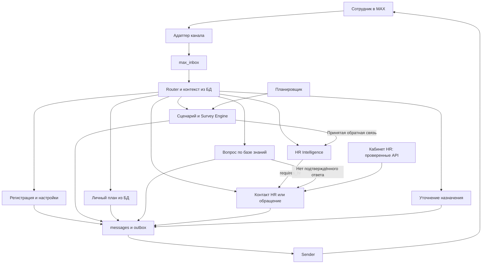

**Логика Router «Корсик» для Полипластика**

Версия проекта логики: 24 октября 2026 года. Это спецификация для реализации и проверки. Работающий Router, Survey Engine, RAG и адаптер MAX этим документом не объявляются реализованными.

**1. Основания и границы**

Логика сопоставлена с тремя источниками:

- Кейс Полипластика: предоставленный `КЕЙС_ПОЛИПЛАСТИК.pdf`, страницы 2, 5 и 6. Требования: MAX, сохранение таймлайна адаптации, персонализация по площадке, свободные вопросы через RAG, анализ обратной связи, передача человеку, гибридный интерфейс, корпоративный стиль, аналитика.
- Excel-сценарий: предоставленный `Финал. ТЗ. Чат-бот Корсик- 15.09.xlsx`, лист `27.02.2026`, содержательные строки 3–70. Важны выбор обращения «ты/вы», варианты ответа, условные комментарии, множественный выбор, команды, площадки, вложения и напоминания.
- Предоставленный `korsik_postgresql17.zip`, фактические schema.sql, operations.sql и examples/backend.py, плюс текущие `app/hr/schemas.py`, `service.py`, `decision.py` и `analyzer.py` рабочего проекта.

Имена таблиц и регистрационные поля в архиве БД являются реализационными решениями автора комплекта. Точные поля кадровой анкеты, численные пороги семантического классификатора и остальные дополнительные настройки не объявляются требованиями компании без основания в первоисточнике.

Текущий HR-модуль рабочего проекта обрабатывает одно событие через `process_hr_input()`. Другая версия модуля в Documents/ChatGPT не используется как действующий контракт.

**2. Карта ответственности**

Router выбирает маршрут и создаёт устойчивую работу для обработчика. Survey Engine владеет ответами и прогрессом опроса. HR Intelligence выделяет сигналы и применяет политику эскалации. Case Service регистрирует обращения и обеспечивает ответ закреплённого HR. RAG отвечает по доступным корпоративным материалам. Outbox/Sender выполняют доставку.

У одного входящего сообщения один основной сценарий ответа. Аналитическая обработка может быть отдельным заданием. Владение ответом для конкретного вопроса согласуется между ботом и HR, чтобы избежать конкурирующих ответов.

**3. Входы в систему**

| Вход | Обработчик | Что считается источником прав |
|---|---|---|
| Текст, кнопка, ответ на сообщение, вложение сотрудника | MAX Adapter → inbox → Router | Проверенное событие канала и связь account/chat с employees |
| Активация приглашения | Invitation Service | Проверенный инвайт и отправитель события |
| Подтверждение доставки | Delivery Handler | Проверенное событие провайдера; отдельный технический маршрут |
| Срок события или напоминания | Scheduler → Scenario/Survey Engine | Внутреннее задание и персональный план |
| Проверка анкеты, назначение плана, ответ HR | API кабинета → соответствующий сервис | Аутентифицированный HR и проверка закрепления/роли |
| Результат RAG или HR-анализа | Worker → сохранение результата | Идентификатор задания, версия входа, generation |

Расписание, ответы HR и результаты worker не проходят распознавание намерения как текст сотрудника. Напоминание запускается независимо от того, написал ли сотрудник боту.

**4. Внутренние контракты Router**

`IncomingEvent`: provider_event_id, channel, kind, occurred_at, account_id, chat_id, text, reply_to_provider_message_id, callback_data, attachments. Адаптер удаляет секрет приглашения из сохраняемого текста и передаёт допустимый нормализованный конверт.

`DialogContext`: employee_id, assigned_hr_id, site_id, lifecycle, registration_step/revision, preferred_address, active_plan_id, актуальные вопросы с их типами и версиями, доступные обращения, pending_interaction, context_revision.

`IntentDecision`: ограниченное намерение свободного текста и необходимость уточнения. Идентификаторы сотрудника, HR, площадки, обращения и вопроса берутся из проверенного контекста. Модель может предложить только один из предоставленных допустимых контекстов; сервер проверяет выбор повторно.

`RouteDecision`: route, reason_code, provider_event_id, target_plan_event_id, target_case_id, pending_interaction_id, context_revision, необходимость HR-анализа и необходимые параметры обработчика.

Идентификаторы имеют разные назначения: `max_inbox.event_id` — внешний ID входящего события; `messages.event_id` — внутренний bigint вопроса/события плана. В коде Router используются разные имена provider_event_id и plan_event_id.

**5. Последовательность обработки**

1. Адаптер проверяет происхождение события, связывает отправителя и приводит событие к IncomingEvent. Подпись кнопки и принадлежность цели проверяются сервером.
2. В короткой транзакции создаётся запись max_inbox с уникальным provider_event_id. Повтор использует существующую обработку. Приём события подтверждается после фиксации.
3. Worker получает inbox с lease/generation. Загружает контекст сотрудника и доступные цели.
4. Явные команды, кнопки и однозначные ответы определяются правилами. Для оставшегося свободного текста классификатор вызывается после завершения транзакции чтения, без удержания блокировок. Его таймаут должен укладываться в lease с запасом либо lease продлевается.
5. Перед применением решения открывается короткая транзакция: проверяются generation, актуальный контекст, владение целью, срок и состояние вопроса. Изменившийся контекст требует повторного решения либо уточнения.
6. Сохраняются входящее сообщение/действие, результат маршрутизации, бизнес-изменения и необходимые задания/outbox. Изменение ответа и прогресса опроса выполняется атомарно.
7. Inbox переводится в done после устойчивого принятия работы. Это означает, что необходимые действия и задания сохранены; завершение анализа и доставка имеют собственные статусы.
8. Worker выполняют модель и внешние запросы вне блокирующих транзакций. Результат применяется только к актуальному заданию. Sender отправляет сообщения через outbox.

В examples/backend.py функция route() вызывается внутри бизнес-транзакции. При добавлении семантической модели нужно вынести её вызов в подготовительную фазу; окончательный выбор внутри транзакции остаётся локальной проверкой правил.

Некорректный ответ, устаревшая кнопка и неоднозначность являются обработанными пользовательскими ситуациями с понятной подсказкой. Технические ошибки используют повторные попытки и отдельный учёт ошибок.

**6. Приоритет маршрутов**

| Порядок | Условие | Решение |
|---|---|---|
| 1 | Проверенное событие доставки | delivery; без анализа текста |
| 2 | Активация приглашения | invitation.activate |
| 3 | Для пользовательского события не удалось установить сотрудника | activation_required; разрешена общая помощь по активации |
| 4 | Явный запрос HR, /HR или соответствующая кнопка | hr.menu / hr.contact / hr.request согласно действию |
| 5 | Глобальная поддерживаемая команда, включая /Food | command/content handler; прогресс опроса сохраняется |
| 6 | Подписанное действие с явной целью | registration, preference, survey, case_followup либо clarification.resolve |
| 7 | Reply на известный вопрос или сообщение обращения | Обработчик привязанной цели после проверки актуальности |
| 8 | Вложение к ожидаемому действию | Приём вложения в соответствующий сценарий |
| 9 | Свободный текст без однозначной привязки | Распознавание намерения с учётом контекста |
| 10 | Неподдерживаемое событие или неизвестное назначение | Подсказка либо clarification |

Неизвестное или просроченное целевое действие завершается ответом об ошибке контекста. Оно не превращается в новый вопрос к базе знаний. Наличие открытого обращения само по себе не делает каждое последующее сообщение продолжением этого обращения.

Пользовательская команда отмены опроса не равна отмене всего адаптационного плана. Полномочия на изменение плана проверяет отдельный сервис.

**7. Семантика свободного текста**

| Намерение и пример | Куда направить | Данные для ответа |
|---|---|---|
| Вопрос по правилам: «Как получить доступ к корпоративному порталу?» | knowledge.question | Доступные документы, площадка, версии и источники |
| Личный статус: «Что мне ещё осталось пройти?» | onboarding.status | Персональный план и ответы из PostgreSQL |
| Сообщение о проблеме: «Не могу работать, доступы так и не выдали» | feedback.analyze | HR Intelligence, source=message |
| Вопрос вместе с жалобой: «Мне не выдали доступ. Что делать?» | feedback_then_help | Сначала решение HR Intelligence; затем Case Service либо RAG |
| Явная просьба человека: «Передайте мой вопрос HR» | hr.request | Закреплённый HR и текущая тема |
| Продолжение ответа/обращения | Соответствующая цель, если контекст однозначен | Проверенные question/case ID |
| Приветствие или «Кто ты?» | conversation.service | Подготовленный корпоративный текст |
| Несколько возможных назначений | clarification | Сохранённый текст и допустимые варианты |

Классификатор возвращает закрытый набор намерений. Политику приоритетов и эскалации выполняет HR Intelligence. При сбое классификатора бот предлагает допустимые действия. Получение непроверенного ответа модели не считается подтверждением маршрута.

Существенные рабочие вопросы могут дополнительно анализироваться для аналитики. Для смешанной жалобы и вопроса анализ обязателен до разрешения автоматического ответа. Регистрация, выбор формы обращения, технические действия, приветствия, сообщения бота и HR не поступают как свидетельства проблем сотрудника.

Если в ответ на запрос комментария приходит новый вопрос без явной привязки к комментарию, его можно обработать отдельно, сохранив ожидающий комментарий. Короткое «нет» при нескольких возможных вопросах требует уточнения. Оригинал сохраняется, повторный ввод не нужен.

Для clarification создаётся pending_interaction с original_message_id, допустимыми целями, revision, сроком и результатом выбора. Позднейшая кнопка имеет свой provider_event_id и разрешает сохранённое сообщение ровно один раз. Завершённый max_inbox.result исходного события не переписывается.

**8. Обработчики, БД и последующие действия**

| Обработчик | Бизнес-действие и сохранение | Последующее действие |
|---|---|---|
| invitation.activate | activate_invitation(), employees/invitations/audit | Регистрация и приветствие |
| registration.answer | save_registration() с revision | Следующее поле или ожидание проверки HR |
| preference.address | Сохранение «ты/вы» в профиле | Подготовленный сценарный ответ |
| content.show | Выбор утверждённого материала по площадке и версии | Текст/карта/PDF/изображение через outbox |
| survey.answer | Валидация ответа, сохранение, ветвление и прогресс | Следующий шаг и HR-анализ содержательной обратной связи |
| survey.comment | Связь с исходным вопросом и ответом | Завершение шага, анализ обновлённого ответа |
| survey.multiselect.toggle | Изменение черновика выбора | Обновление интерфейса выбора |
| survey.multiselect.submit | Одна финальная фиксация допустимого набора | Следующий шаг и одно задание анализа этой версии |
| onboarding.status | Чтение активного плана сотрудника | Ответ на основе фактических записей |
| knowledge.question | messages.rag_status и устойчивое задание RAG | Ответ с источниками либо передача HR |
| feedback.analyze | HRInput → process_hr_input() → сохранение результата | Case Service при необходимости |
| hr.menu | Показ двух способов связи | Контакт HR или передача через бота |
| hr.contact | Чтение проверенного контакта закреплённого HR | Кнопка перехода; факт прочтения HR не утверждается |
| hr.request | Сохранение явного запроса и open_hr_case() | Подтверждение регистрации и доступ для HR |
| hr.case_followup | Добавление сообщения к проверенному контексту обращения | Уточнение для того же HR |
| clarification.resolve | Применение выбора к сохранённому сообщению | Один окончательный бизнес-маршрут |
| delivery | confirm_delivery() | Только обновление факта доставки |

Внутренние маршруты API кабинета: проверка регистрации, назначение и настройка плана, публикация материалов, ответ и закрытие обращения, чтение аналитики. Они используют идентичность HR из сессии и объектные проверки доступа. Руководитель подразделения и руководитель HR из кейса требуют собственных областей доступа; имеющиеся hr/admin не покрывают эти роли автоматически.

**9. Правила Survey Engine из Excel-ТЗ**

- «Ты/вы» — настройка общения, F5:F6. Она влияет на подготовленные тексты и стиль ответа.
- Одиночный выбор и разные реплики — F16, F22:F23, F39:F41, F49, F62:F63.
- Отрицательный ответ «нет» требует комментарий там, где это явно задано вопросом, F47/F64. Это параметр конкретного вопроса.
- Оценка 1–10 ниже 8 переводит вопрос в ожидание комментария, F47/F64. Оценка 8–10 позволяет завершить вопрос согласно его настройке.
- Множественный выбор — второй вопрос F55/F56. Пользователь подтверждает набор отдельным действием. Взаимоисключение «Никто» и других вариантов задаётся в конфигурации вопроса как предлагаемое правило валидации.
- «Свой вариант» открывает текстовый ввод, F55/F56/F62. Такой ответ сохраняется вместе с идентификатором выбранной опции.
- Внутри опроса сохраняется возможность обратиться к рекрутеру или передать проблему через бота, F39:F41/F57/F63. Ожидаемый вопрос и возможность продолжения сохраняются.
- Структурированный ответ с существенным сигналом, например «Нет, задумываюсь об уходе» из F63, передаётся в анализ сразу после принятия. Дополнительный комментарий не должен откладывать обработку уже сохранённого сигнала.
- Для финального текстового ответа анализ выполняется после его сохранения. Для незавершённого множественного выбора анализ ещё не запускается.

F47 и F64 содержат несколько вопросов в одной ячейке. При подготовке сценария они разбиваются на отдельные типизированные вопросы с собственными ID; в HRInput.question передаётся формулировка одного вопроса, а не весь сценарий из Excel.

В пределах одной сессии предлагается показывать один вопрос, требующий ввода, за раз. У уже отправленных разных событий может сохраняться собственная привязка. Информационные сообщения и отдельные вопросы по базе знаний могут обрабатываться между ответами.

**10. Подключение текущего HR Intelligence**

| Источник | HRInput.source | Заполнение |
|---|---|---|
| Самостоятельное сообщение с обратной связью | message | provider_event_id, employee_id строкой, оригинальный текст |
| Ответ/комментарий опроса | survey | provider_event_id, employee_id, survey_session_id, question_id, формулировка вопроса, score при соответствующем типе, текст |
| Явная передача HR | hr_request | provider_event_id, employee_id, имеющийся текст; пустой текст допустим |

Для выбранного варианта в text передаётся точная подпись выбранного ответа. Для нескольких вариантов — точные выбранные подписи в стабильном порядке. Это сохраняет проверяемость цитат. Поля score и question готовятся из доверенной конфигурации и ответа. Выбор А/Б/В или «да/нет» не преобразуется в шкалу 1–10.

Для типов оценок из F47/F64 направление шкалы соответствует текущему правилу: низкое значение означает худшую оценку. Нужен явный тип шкалы, чтобы будущая обратная шкала не использовала то же правило автоматически.

Текущая политика рабочего проекта:

- intent_to_leave и harassment дают high и requires_hr=true.
- unclear_tasks, access_problem, conflict и harassment входят в auto_escalate_categories.
- Оценка ниже 8 без дополнительных сигналов даёт medium; escalate_medium=false по умолчанию. Само правило запроса комментария не означает автоматическое обращение по любой низкой оценке.
- Явный запрос HR должен сохраняться независимо от доступности модели. При пустом тексте текущий сервис возвращает no_data с TicketDraft.

Это текущие настройки реализации, а не полный утверждённый перечень красных флагов компании. Порог запроса комментария основан на Excel; категории и правила автоматической эскалации требуется держать версионированной политикой.

Сохраняются полный результат, категория, приоритет, цитаты, версия модели/политики, статус и ошибка. Результат и необходимое открытие/обновление обращения фиксируются атомарно либо через устойчивое задание. Наличие result.ticket проверяется отдельно от result.status: ticket бывает и при no_data/error.

Повторный анализ комментария к тому же ответу использует стабильную связь с исходным ответом и обращением. Уникальность root_message_id в hr_cases сама по себе не объединяет разные сообщения одного ответа — эту связь должен установить репозиторий. Повторный сигнал обновляет подходящее существующее обращение с учётом его состояния вместо создания дубликата на каждую версию анализа.

**11. RAG и передача человеку**

1. Вопрос сохраняется и создаётся pending-работа. Контекст площадки и разрешения ограничивают источники до передачи фрагментов модели.
2. RAG получает доступные актуальные материалы, готовит ответ и ссылки на конкретные версии/фрагменты.
3. При сохранении и перед отправкой перепроверяются источники, актуальность работы и владение вопросом.
4. Если подтверждённого ответа нет, создаётся передача закреплённому HR с причиной no_answer и понятным подтверждением. Технический сбой поиска получает error и повторную попытку; его нельзя выдавать за отсутствие информации в документах. Кнопка HR остаётся доступной.
5. Если HR Intelligence обнаружил требующий эскалации сигнал до отправки ответа бота, Case Service принимает вопрос и отменяет pending-ответ RAG.

При mixed-сценарии HR Intelligence определяет дальнейший путь до отправки автоматического ответа. Если requires_hr=false, справочная часть может идти в RAG. При технической ошибке обязательного анализа сообщение остаётся в устойчивой работе, сотруднику доступна явная передача HR.

Для уже sending/uncertain исходящего ответа текущая open_hr_case() откладывает передачу до выяснения результата внешней отправки. Запрос HR сохраняется; подтверждение фактической передачи отправляется после регистрации case. Гарантировать отзыв уже начатой внешней отправки невозможно.

**12. Два способа связи с HR**

`/HR` показывает меню: «Связаться напрямую» и «Передать через Корсика». Это проектное решение, сохраняющее обе возможности из Excel.

Прямой контакт: сервер получает контакт закреплённого HR и отдаёт проверенную ссылку/кнопку. Бот не обещает получение сообщения человеком и не создаёт автоматически дублирующее обращение только из-за показа контакта.

Передача через Корсика: явный запрос регистрируется сразу. Если есть исходная проблема/ответ, сохраняется связь с ним. Если текста нет, допустим общий запрос связи. Последующие подробности явно привязываются к созданному case. Надпись кнопки является действием, а не текстовой цитатой о проблеме для модели.

Ответ HR поступает из кабинета через prepare_hr_reply(), сохраняется с автором hr и отправляется без нейросетевого пересказа. Закрытие обращения и доставка должны иметь согласованные отдельные правила; в исходной схеме закрытие зависит от verified receipt.

**13. Планировщик и персонализация**

HR назначает опубликованную версию плана, а персональные события получают снимки контента, сроки, площадку и локальное время. Будущая дата выхода допускает предвыходные события за 2–3 дня.

Планировщик выбирает наступившее событие, а Scenario/Survey Engine решает, какое сообщение или первый вопрос требуется показать. Зависимые вопросы не отправляются всем пакетом из-за одинакового scheduled_at.

Напоминания по F70 относятся к незавершённому опросу на следующий и последующий день. Нужно согласовать обработку часового пояса и рабочего календаря. Текущие offset_days считают календарное смещение, тогда как Excel использует и «третий рабочий день», и календарные сроки. Это задача подготовки расписания по корпоративному календарю.

Повторный tick не создаёт дубль. Выполненный опрос не получает новое напоминание. Отдельный FAQ-вопрос не завершает и не отменяет ожидающий ответ.

Площадки GrPP/GTP/Luzhniki определяют утверждённые карты, питание, транспорт, контакты и варианты вопросов. Площадка связывается с кадровой карточкой; org_unit_id не объявляется площадкой автоматически. При неизвестной площадке бот выдаёт общий материал либо запрашивает проверку данных, не подставляя чужой локальный контент.

После завершения адаптации предлагается остановить автоматические опросы, сохранив доступ к справке и HR. Это проектная политика, которую следует отделять от прощального текста сценария.

**14. Обязательные дополнения к предоставленной БД**

| Дополнение | Причина |
|---|---|
| Типизированные choice/multiselect, варианты, выбранные значения и условные комментарии | F39:F41, F47, F55:F57, F62:F64; текущие CHECK поддерживают только info/task/rating/feedback |
| Группы/сессии опроса, порядок вопросов и версия текущего взаимодействия | Последовательный опрос, возврат после отдельного вопроса, защита от старых действий |
| pending_interactions с исходным сообщением и конечным результатом выбора | Уточнения, ввод собственного варианта, продолжение контекста |
| Площадка, форма обращения и проверенный контакт HR | Варианты сценария и два способа связи |
| Вложения и действия исходящих сообщений | Карты, PDF, фото, открытки и кнопки из Excel; нынешние messages/outbox сохраняют главным образом body |
| Полный результат и задания HR-анализа, приоритет/категория case, связь с источником | Совместимость с действующим HRResult и надёжная эскалация |
| Правило закрытия case независимо от доступности receipts | Возможность завершить обработанное обращение при подходящей бизнес-политике |

Текущие employees, max_inbox, messages, employee_plans, plan_events, hr_cases и outbox сохраняются как основа. Новые типы ответов требуют изменения связанных CHECK, функций и защиты истории, а не только добавления поля в Python.

**15. Проверочные истории**

| История | Ожидаемое поведение |
|---|---|
| «Нет» в ответ на «Понятны ли задачи?» | Сохранить выбор в конкретном вопросе, запросить комментарий по настройке, передать принятую обратную связь в анализ |
| Оценка 7 без текста | Сохранить score, ждать комментарий; текущая политика не открывает case только по низкой оценке |
| Пока ожидается комментарий, сотрудник вызывает /Food | Выдать материал его площадки; вопрос и оценка остаются прежними |
| «Как получить доступ к порталу?» | RAG по разрешённым источникам; без выдумывания инструкции |
| «Доступы не выдали, работать не могу» | HR Intelligence; при access_problem текущая политика требует HR |
| Выбран ответ «Нет, задумываюсь об уходе» | Сразу обработать сохранённую обратную связь; текущая политика высокого приоритета применяется к подтверждённому сигналу |
| «Не хочу увольняться» | Отрицание учитывается анализатором; подстрока об увольнении не служит самостоятельным правилом высокого риска |
| Нажата передача HR при недоступной модели | Запрос регистрируется; отсутствие модели не теряет явное действие |
| Показан прямой контакт HR | Кнопка открывает разрешённый контакт; получение/ответ человека не утверждаются |
| Старая кнопка оценки | Ответ «Этот вопрос уже завершён/изменился»; без изменения нового вопроса |
| Выбор нескольких пунктов | Toggle меняет черновик; submit сохраняет один окончательный набор |
| Неоднозначное сообщение | Сохранить текст и предложить назначение; выбор обрабатывается один раз |
| Повтор provider_event_id | Одно бизнес-применение |
| Перезапуск после сохранения ответа | Задание анализа и прогресс восстанавливаются из БД |
| Модель завершилась после потери lease | Устаревшая generation не применяет результат |
| Технический сбой RAG | Отдельный error/retry; без ложного заключения «в документах нет ответа» |
| Ответ уже готовит HR | Автоматический ответ на тот же вопрос не ставится повторно в отправку |

**16. Порядок реализации**

| Этап | Что получается | Проверяемый результат |
|---|---|---|
| 1 | IncomingEvent, DialogContext, RouteDecision, чистые правила и реестр обработчиков | Явные команды, цели, устаревшие действия и неоднозначность маршрутизируются предсказуемо |
| 2 | Репозитории inbox/messages/context, pending_interactions, задания и идемпотентность | Повторы, конкурентные действия и перезапуск сохраняют одну обработку |
| 3 | Адаптер действующего HR Intelligence и Case Service | Сохраняются полный анализ, явный запрос и автоматическая эскалация |
| 4 | Расширенная модель Survey Engine и подготовленные сценарии Excel | Choice, multiselect, комментарии и продолжение после прерывания проходят проверочные истории |
| 5 | RAG, личный план, материалы площадки и семантический классификатор | Свободные вопросы получают правильный источник; модель работает вне транзакционных блокировок |
| 6 | MAX Adapter, Sender, вложения и Scheduler | Сквозной сценарий от события канала до ответа и напоминания на целевой БД |
| 7 | Кабинет HR, области доступа и аналитика | Корректное закрепление HR, ответ человеку, данные для предусмотренных кейсом представлений |

Сквозная приёмка выполняется с реальным адаптером MAX и целевой PostgreSQL, с несколькими сотрудниками, площадками и HR. Отдельно проверяются ситуации из раздела 15.

**17. Расхождения первоисточника, которые следует сохранить явно**

- В B53:B56 расписание обозначено как «через 1 месяц и 3 недели», а F54 описывает опрос «после двух месяцев». В машинном сценарии нужна одна выбранная дата; молча вычислять её из противоречивого текста нельзя.
- Правило F70 сформулировано как напоминания «на завтра + на послезавтра», тогда как архив БД использует интервалы в часах от фактического принятия отправки и фиксированные сроки от scheduled_at. Это разные правила для задержанной отправки; их нужно унифицировать в конфигурации планировщика.
- Фото и представление коллегам в F34 требуют вложений и отдельного сценарного действия. Публикация во внешний канал не считается разрешённой только фактом загрузки фото сотрудником.

Эти пункты не мешают реализовать ядро Router и основные обработчики. Они фиксируются как явные параметры/открытые условия сценария, а не как скрытые догадки классификатора.
