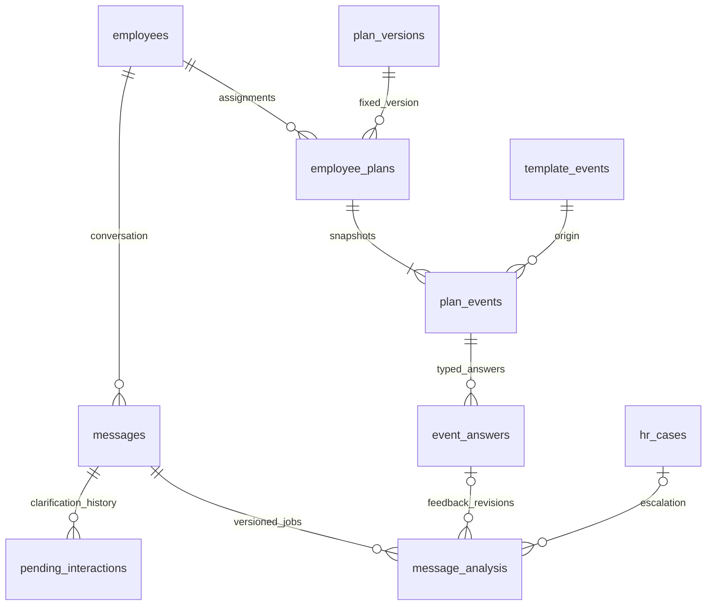

# Корсик — PostgreSQL 17, редакция 2

Комплект обновлён по приложенной спецификации от **24 октября 2026**. Есть первая установка в пустую БД и отдельная миграция с выпущенной схемы версий 1/2 на версию 3. Реальная корпоративная БД не подключалась и не изменялась.

**Начните здесь:** [результаты проверки](TEST_RESULTS.md) → [запуск Docker и миграция](docs/operations.md) → [контракты и операции](docs/transactions.md) → [полный словарь таблиц](docs/data_dictionary.md).

## Архитектура и границы

PostgreSQL хранит карточки, регистрацию, версии и персональные планы, ответы, переписку, состояния inbox/outbox, уточнения Router и задания/результаты анализа. Redis может ускорять работу, но не хранит единственную копию состояния. Qdrant остаётся отдельным поисковым индексом корпоративных документов; личные ответы и фото туда не поступают.

Scheduler выполняет короткие транзакции и готовит сообщения. Sender сначала сохраняет lease, затем после COMMIT вызывает MAX, затем фиксирует результат. Внешние модели и классификатор вызываются вне транзакционных блокировок. Защита входящих повторов по-прежнему глобальная: max_inbox.event_id, независимо от даты/месяца.

Добавлены **две** таблицы, а не параллельная платформа: event_answers и pending_interactions. Существующая message_analysis расширена до durable jobs/results. Итого **22 таблицы: 21 бизнес-таблица и schema_migrations**. Все таблицы/PK/FK/типы/NULL/CHECK/индексы приведены в словаре, выгруженном из реально созданного каталога.

Работающий MAX Adapter, семантический Router, корпоративный импортёр Excel и действующий process_hr_input() не выдаются за реализованные. Исходников упомянутого app/hr/ в этом чате нет. SQL и контракты готовы для их подключения; пример backend обновлён, двухфазная интеграция Router показана отдельно.

## Что изменилось по пунктам 1–6

| Требование | Реализация |
|---|---|
| Несколько вопросов | kind=survey; versioned definition; event_answers PK(event_id,question_code); current_question_code + interaction_revision |
| Типы ответов | rating, boolean, single_choice, multi_choice, text, attachment; комментарий отдельным действием; проверки опций и эксклюзивного выбора |
| Разговор и прерывания | Одна активная интерактивная форма на сотрудника, включая task/rating/feedback; info/RAG/HR продолжаются; вопрос про отпуск не потребляет комментарий |
| Персонализация | location_tag, employee_type, communication_style; аудитория/варианты в definition; снимок выбранного текста и вопросов при назначении |
| Рабочий календарь | work_calendar со weekdays/holidays/extra_workdays; workday_no; start_date или probation_end_date; расчёт в SQL, без внешних расширений |
| Исходящие материалы | Ограниченный messages.payload: кнопки, target/revision, attachment IDs, роли prompt/completion; queue_message и claim_outbox передают payload |
| Разные сроки | send_until_at — актуальность первоначальной отправки; deadline_at начинается от первого принятия API; пребординг ограничен началом дня выхода |
| Последовательная доставка | Не более одной sending/uncertain на сотрудника, частичный UNIQUE в outbox; не более одной записи сотруднику на claim, включая после COMMIT |
| Устаревшие prompts | Проверяются purpose=notice с role=prompt, текущий вопрос, revision и срок; нужный completion не отменяется |
| До эксплуатационного согласования | Пример sender использует claim_outbox(1,true): глобальный барьер sending/uncertain. Один delivery worker/concurrency=1 |

Оценки/task/feedback сохраняют API answer_event(). Их существующие ответы не переносятся в event_answers и не дублируются. Только новый survey использует новую таблицу.

## Дополнения из Router-спецификации

- pending_interactions сохраняет оригинальное сообщение, допустимые цели, контекстную revision, срок и финальный выбор. Исходный max_inbox.result не переписывается.
- message_analysis хранит неизменный вход HRInput, model/policy versions, lease/generation, полный результат, ошибку и связь с ответом/case. PK теперь bigint id; бизнес-уникальность — source_key/input_revision/model_version/policy_version.
- HR-cases имеют стабильный source_key, категорию/приоритет и ссылку на вопрос. Повторный анализ/комментарий обновляет подходящее открытое обращение; устаревшая revision не открывает новое.
- Смешанная жалоба и вопрос получают analysis_gate=pending: RAG не запускает/не отправляет автоматический ответ до решения обязательного анализа.
- TicketDraft при no_data/error сохраняется и вызывает передачу HR независимо от успешности модели. Явный запрос человека может сразу вызвать open_hr_case без модели.
- close_hr_case различает verified_delivery и api_accepted с обязательной заметкой HR. Второе не подделывает delivered_at.
- Проверенный прямой контакт закреплённого HR хранится отдельно от обращения. Пока contact_verified_at отсутствует, прямой контакт не выдаётся.
- Документу добавлен nullable scope_location_tag для проверки площадки наряду с org_unit. Это узкая проверка доступа; поисковый пайплайн, версии и Qdrant не заменены.

## Принятые решения и ограничения

1. GrPP/GTP/Luzhniki и office/production — закрытые значения из предоставленной спецификации. Подразделение не выводит площадку автоматически. При неизвестной площадке выбирается только общий контент.
2. definition — закрытый JSON-контракт до 64 KiB и 50 вопросов. Нет произвольного workflow. Условия ссылаются только на более ранний вопрос и поддерживают equals/contains. Варианты аудитории не могут неоднозначно совпасть.
3. Низкая оценка 1–7 требует комментария. Для rating обязательна scale_direction=low_bad. Другие направления требуют отдельного согласованного расширения. Boolean/choice не становятся числом 1–10.
4. Multi-select toggle меняет только draft и revision. Submit сохраняет окончательный канонический набор в порядке вариантов; draft не анализируется. Старые кнопки отклоняются. «Никто» исключает другие пункты, если задан exclusive_options.
5. Ответ/сигнал анализируется сразу после сохранения, даже если ещё нужен комментарий. Комментарий создаёт новую input_revision того же source_key. Это не означает автоматическую эскалацию любой оценки ниже 8.
6. Календарь по умолчанию — технический пример Пн–Пт без праздников, **не утверждённый график компании**. Производственные смены/праздники должен передать HR. Календарь плана неизменен: для другого графика назначается замена плана. Перенос даты/зоны/конца испытательного срока меняет только scheduled-события штатной функцией.
7. workday_no считает первый рабочий день начиная с якоря включительно; при нерабочем якоре берётся следующий рабочий день. workday_no нельзя смешивать с offset_months/offset_days. Месяцы остаются календарными.
8. Для начала окна ответа accepted_at означает момент подтверждения принятия API в БД. Provider delivery может предшествовать записи acknowledgement; delivered_at не сравнивается с ним CHECK. Exactly-once внешняя доставка не обещается.
9. Истёкшая sending-аренда становится uncertain. Очередь останавливается до сверки; автоматический массовый retry uncertain запрещён. После начала HTTP-вызова PostgreSQL не может гарантировать отзыв сообщения, ставшего неактуальным в сети.
10. Актуальная форма освобождает слот при завершении/пропуске/отмене/просрочке. Истечение обрабатывается scheduler; для sending/uncertain сначала нужна сверка, а не притворное освобождение.
11. Строковые asset_ref — ссылки на уже проверенные объекты общего backend, не байты/подписанные секретные URLs. Backend проверяет владельца, существование, антивирус/разрешённый тип до записи ответа. Фото не даёт согласия на публикацию во внешний канал.
12. Версии модели и политики приходят из конфигурации реального сервиса. При отсутствии конфигурации job сохраняется как unconfigured и не исполняется; bind_unconfigured_analysis привязывает новую версию без потери исходного задания. Демонстрационные labels не объявляются настоящей моделью.
13. HR получает только своих сотрудников через обязательную авторизацию backend. RLS не добавлен; один hr_id не доказывает изоляцию чтения. Новые роли руководителей не объявлены реализованными.
14. Масштаб/retention остаются допущениями: до 3 000 сотрудников, 10 000 сообщений/сутки, 24 месяца сообщений/аудита. Партиций нет. Автоматического удаления нет. Реальные показатели и сроки хранения не установлены.
15. Противоречие B53:B56/F54 о дате позднего опроса не разрешено догадкой. Девять/двенадцать вопросов в демо — типизированные иллюстрации, **не полная утверждённая транскрипция Excel**. Медиаматериалы по строкам Excel не предоставлены. Полный shared-режим включается после проверки контента, даты и asset IDs.

## Логическая модель

| Группа | Таблицы и назначение |
|---|---|
| Люди/регистрация | hr_users — доступ/контакт HR; org_units — подразделения; employees — одна карточка и контекст; invitations — одноразовые секреты |
| Планы | plan_templates/plan_versions/template_events — версии; employee_plans — назначения/календарь; plan_events — выбранные снимки/сроки/диалог |
| Ответы | event_answers — несколько типизированных ответов survey; простые legacy-ответы остаются в plan_events |
| Переписка | max_inbox — повторы/обработка; messages — автор/текст/payload; outbox — внешняя доставка |
| Router/HR | pending_interactions — уточнение оригинала; hr_cases — вопрос закреплённому HR; message_analysis — задания и результаты |
| Источники | documents/document_versions/document_chunks/answer_sources — доступ, версии, Qdrant IDs, цитаты |
| Сопровождение | audit_log — значимые действия; schema_migrations — версии установки |



Полные связанные части ERD: [планы](erd.mmd), [сообщения/Router](docs/erd_messaging.mmd), [документы](docs/erd_documents.mmd). Все решения о PK/FK/индексах и их цене — [data_dictionary.md](docs/data_dictionary.md).

Объяснения ключевых понятий: [basics.md](docs/basics.md). Соответствие пяти таблицам старого SQLAlchemy-модуля: [onboarding_mapping.md](docs/onboarding_mapping.md).

## Установка и проверка

В пустой выделенной БД порядок: permissions.sql администратором → install.sql от SET ROLE korsik_owner → grants.sql → seed_demo.sql. install.sql содержит исторические миграции 1/2 и миграцию 3; **schema.sql отдельно не является актуальной установкой v2**.

Для существующей выпущенной v1: остановить writers/scheduler/sender → backup и rehearsal → применить **только migrations/003_survey_router.sql** владельцем → обновить backend → проверить → включать worker. Нельзя накатывать install.sql повторно. Миграция откажет при нескольких активных формах/неопределённых отправках сотруднику, не отменяя их молча. Неизвестная командная схема не объявляется совместимой с этим upgrade.

Точный Docker runbook — [operations.md](docs/operations.md). Порядок проверок на disposable test DB:

```bash
psql -X "$TEST_OWNER_DSN" -v ON_ERROR_STOP=1 -c 'SET ROLE korsik_owner' \
  -f install.sql -f grants.sql -f seed_demo.sql \
  -f tests/invariants.sql -f tests/flows.sql \
  -f tests/delivery_serial.sql \
  -f seed_survey_demo.sql -f tests/survey_router.sql
# Два независимых серверных соединения; файлы не отправляют ничего в MAX.
KORSIK_TEST_ALLOW_WRITE=1 KORSIK_TEST_DSN="$TEST_APP_DSN" python tests/concurrency.py
# Сохраняемый демонстрационный сценарий:
psql -X "$TEST_OWNER_DSN" -v ON_ERROR_STOP=1 -c 'SET ROLE korsik_owner' \
  -f walkthrough.sql -f walkthrough_survey.sql
```

TEST_*_DSN поступают из защищённого окружения. Для примеров SQLAlchemy/psycopg и конкретных новых операций — [transactions.md](docs/transactions.md). Первая установка ролей и настоящие подключения описаны в Docker runbook; пароли в репозиторий не включены.
